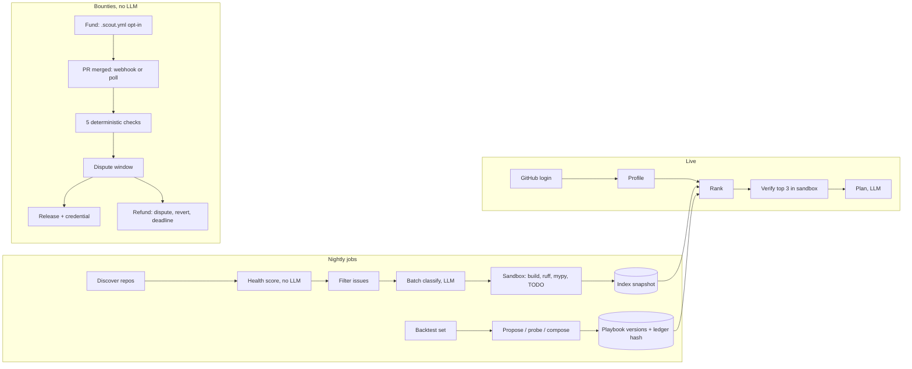

# Scout

Scout finds open source contributions matched to a developer's skills, verifies in a sandbox
that they are real and buildable, writes a contribution plan, and pays issue bounties when real
work is merged. Core intelligence runs on open-weight models through an OpenAI-compatible
endpoint (DigitalOcean Gradient by default). Bounty payouts never depend on a model.

> Status: local-only build. GitHub, the LLM and the ledger run on fixtures and mocks.
> **Interim design:** bounty escrow is a backend-held wallet, not a non-custodial on-chain
> program. Amounts are "test USDC" base units (6 decimals).

## Run the local demo

Requires Python 3.12 and [uv](https://docs.astral.sh/uv/). No accounts, keys or network.

```sh
uv sync
cp -n .env.example .env        # only if you have no .env yet; defaults are all local
uv run scout index             # Algorithm 1: build the repo index
uv run scout nightly           # Algorithm 4: v1 -> v2 on the backtest
uv run scout serve             # http://127.0.0.1:8000
```

In the browser:

1. **Find contributions**: pick `newbie` or `devjane` and click *Find matches*. Each top match
   shows its score breakdown, four sandbox verification checks and a contribution plan.
2. **Bounties**: fund `acme/tinycsv` issue 12. Then *Simulate merge webhook* with PR 21
   (passes all five checks) or PR 22 or 23 (each fails different checks). A verified bounty
   waits out the dispute window (set `DISPUTE_WINDOW_SECONDS=180` for the demo), and then
   *Poll merges & settle due* releases it and writes a credential. *Dispute* refunds it.
3. **Self-improvement**: see the precision@10 history, the proposed edits and whether each was
   kept. Click *Verify* to recompute a version hash and compare it with the ledger record.

The same flow from the CLI: `scout match newbie`, `scout fund acme/tinycsv 12 10`,
`scout pr-merged acme/tinycsv 21`, `scout tick`, `scout dispute <id>`, `scout verify 2`.

## How it works



- **Ports and adapters** (`src/scout/ports.py`): LLM, batch LLM, GitHub, sandbox, object store
  and ledger. `src/scout/wiring.py` is the only place that picks local or cloud adapters.
- **Untrusted content**: every repo, issue and comment string in a prompt is wrapped by
  `scout.prompts.untrusted` in a randomly tagged block.
- **Sandbox** (`adapters/local/sandbox.py`): fresh workdir outside the project, no inherited
  environment, timeout, and an audit hook for code that runs repo code (no reads outside the
  sandbox and Python install, no writes outside the workdir, no subprocesses, no sockets).
  Python-level only: cloud mode needs an OS-level sandbox.
- **Bounty release** (`scout/bounty.py`): merged to the default branch, merged by someone else
  with write access, PR closes the issue, CI green, non-trivial diff. The checks run again at
  signing time, after the dispute window.
- **Maintainer opt-in**: a `.scout.yml` on the default branch containing `bounties: true`.

## Development

```sh
uv run pytest
uv run ruff check . && uv run ruff format .
uv run mypy src
```
